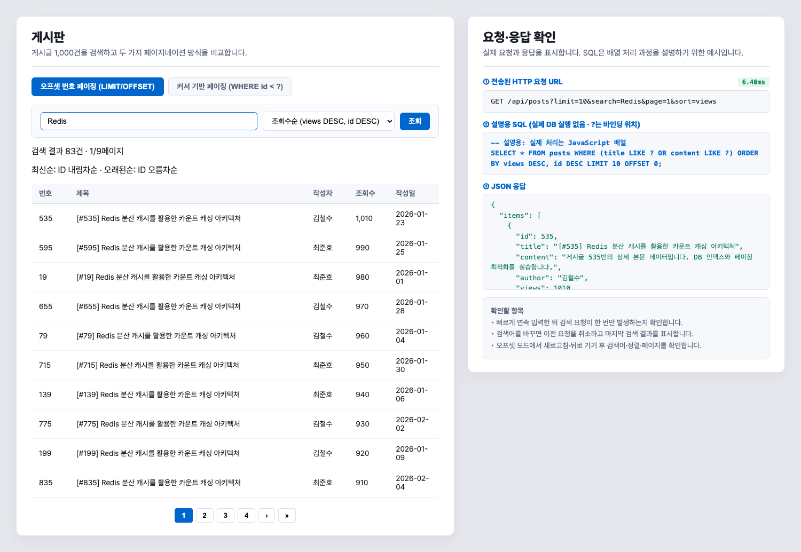
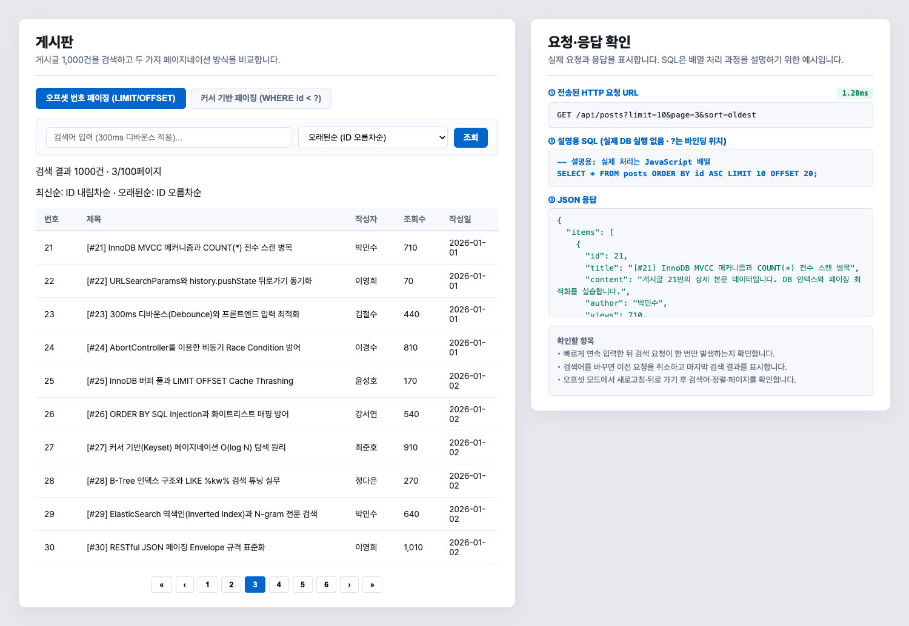
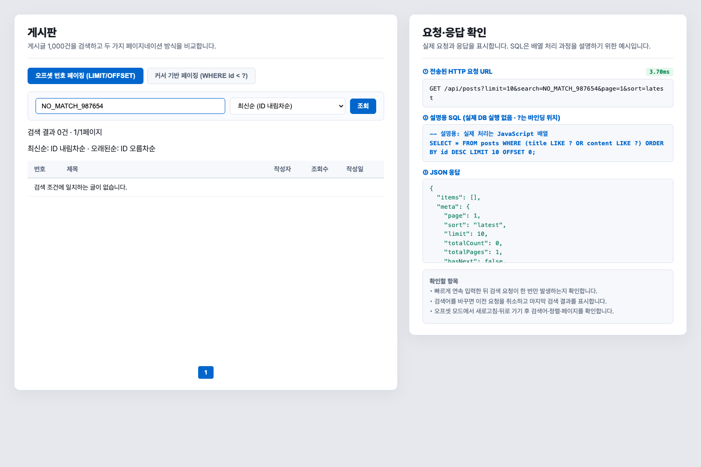
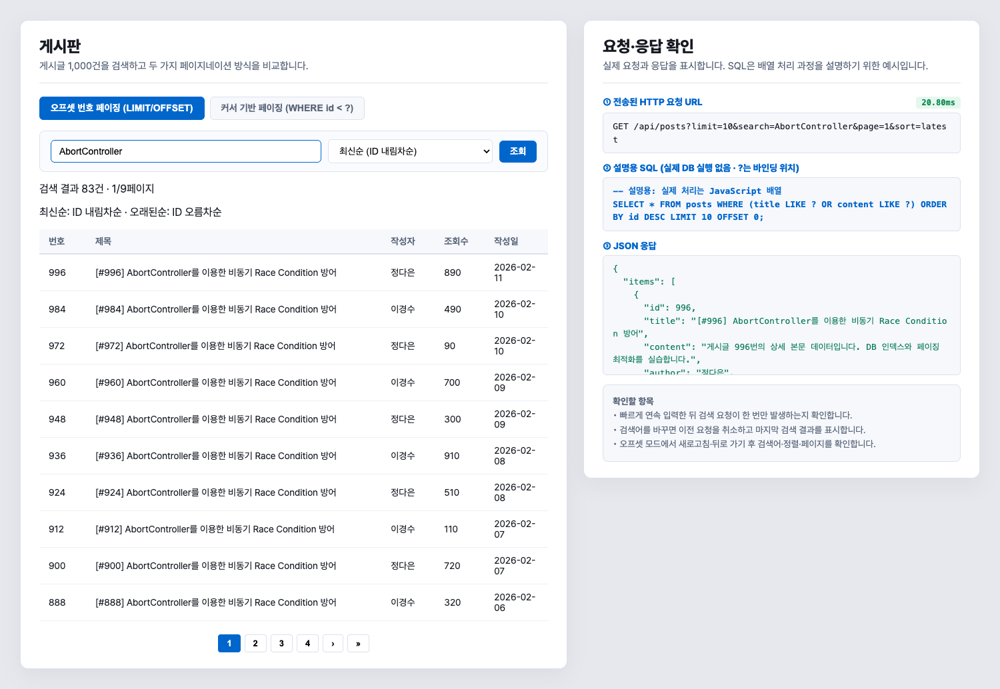

# 검색·정렬·페이지네이션 게시판 개선

이름: 이주호 · 학번: 202116786

실습일: 2026-11-08

## 1. 실행 환경

예제를 실행해 문제가 있는 기능을 확인하고, 코드를 수정한 뒤 같은 입력으로 다시 테스트했다. 데이터는 예제와 같은 1,000건의 인메모리 배열이다. 실제 데이터베이스는 사용하지 않았다.

환경: {{ENVIRONMENT}}. 실행은 `npm ci`, `npm start` 순서이며 접속 주소는 http://localhost:3000 이다. 자동 테스트는 서버를 종료한 다음 `npm test`로 실행한다.

## 2. 수정 전 기능 확인

| 테스트 | 기대 결과 | 수정 전 실제 결과 |
|---|---|---|
| sort=__proto__ | 기본 정렬로 조회 | HTTP 500 오류 |
| sort=constructor | 기본 정렬로 조회 | HTTP 200이지만 상속 속성을 비교 함수로 사용 |
| 커서에서 없는 검색어 입력 | 빈 목록 | 검색어와 관계없이 10건 반환 |
| 커서 모드 전환 | 정렬 고정 안내 또는 선택 비활성화 | 정렬 선택 가능 |

`constructor`는 응답 코드만 확인해서는 문제를 찾기 어려웠다. 객체에서 키를 바로 읽으면 상속된 속성도 선택되므로, 수정 후에는 기본 정렬이 선택됐는지와 첫 게시글 ID까지 확인했다. 실행 기록은 `baseline-results.json`, 원본 코드는 `original/`에 보관했다.

추가로 코드를 확인해 보니 이전 요청은 새 검색어를 입력한 순간이 아니라 다음 요청을 보낼 때 취소됐다. 서버에서 페이지를 보정해도 URL에는 요청했던 페이지가 남을 수 있었고, 화면에 표시된 정렬 설명도 실제 ID 정렬과 달랐다.

## 3. 수정 내용

| 위치 | 기존 | 변경 후 |
|---|---|---|
| server.js 정렬 | 정렬 객체의 키를 바로 조회 | Object.hasOwn으로 자체 속성만 허용, 잘못된 값은 latest |
| server.js 커서 API | ID 조건만 적용 | 제목·본문 검색과 ID 조건을 적용한 뒤 limit+1개 확인 |
| server.js 입력값 | parseInt로 앞부분 숫자만 읽음 | 양의 안전 정수만 허용하고 limit 상한 적용 |
| server.js 데이터 | 랜덤 조회수, 날짜와 ID 순서 불일치 | 동점이 있는 고정 조회수, ID 순서에 맞는 날짜 |
| index.html 커서 화면 | 검색어 누락, 정렬 선택 가능 | 검색어 전달, ID 내림차순 안내, 정렬 선택 비활성화 |
| index.html 검색 | 다음 요청 시작 시 이전 요청 취소 | 입력 즉시 취소하고 요청 번호도 확인 |
| index.html 검색 변경 | 누적 목록·타이머 관리가 여러 곳에 분산 | 목록·커서를 초기화하고 수동 조회 시 타이머 취소 |
| index.html URL | 읽어 온 값을 적용하는 데 그침 | 서버가 보정한 page도 상태·URL에 반영 |
| index.html 표시 | 게시글을 innerHTML로 삽입, SQL 실행처럼 안내 | textContent로 삽입, SQL은 설명용임을 표시 |

최신순은 ID 내림차순, 오래된순은 ID 오름차순으로 정했다. 조회순은 조회수가 같을 때 ID 내림차순으로 비교한다. 조회수와 날짜를 고정한 이유는 서버를 다시 실행해도 같은 조건에서 테스트하기 위해서다. 전체 변경 내역은 `changes.diff`에 있다.

기존 예제의 오프셋 검색, 정렬 함수, 디바운스, AbortController, URL 복원 구조를 바탕으로 수정했다. 커서는 검색 조건과 `id < cursor` 조건을 적용한 뒤 limit+1개를 확인한다. 추가 확인용 항목은 반환 목록에 넣지 않는다.

### 커서 표시와 한글 입력

URL에 limit=100을 지정하고 커서 모드로 바꾸면 API는 50개만 반환하지만 버튼과 SQL 설명은 다른 수량을 표시했다. 커서 요청·버튼·SQL 설명을 모두 최대 50개로 맞추고, 오프셋으로 돌아오면 기존 limit=100을 유지하도록 수정했다.

한글을 조합하는 도중에는 검색하지 않고 조합이 끝난 뒤 300ms를 기다리도록 composition 이벤트도 처리했다. 서버 오류가 발생했을 때 안내가 표시되고 조회 버튼으로 다시 요청할 수 있는지도 확인했다.

## 4. 테스트 결과

다음 결과는 로컬 서버와 Chrome을 연결한 자동 테스트로 확인했다. {{TEST_COUNT}}개 테스트가 통과했으며 실패 {{FAILED_COUNT}}개, 건너뜀 {{SKIPPED_COUNT}}개다. 한 테스트 안에서 여러 입력값을 검사한다. 제출 소스를 별도 폴더에 풀고 기존 node_modules 없이 npm ci로 설치한 뒤 실행했다.

| 평가 항목 | 테스트 입력·조작 | 기대 결과 | 실제 결과 |
|---|---|---|---|
| 검색·정렬 25점 | Redis / 상세 본문 / NO_MATCH_987654 | 제목·본문 검색, 없는 결과 안내 | 83건 / 1,000건 / 0건과 안내 |
| 검색·정렬 | latest, oldest, views로 1,000건 비교 | 지정한 순서, 조회수 동점 ID DESC | 전체 순서 일치, 동점 확인 |
| 검색·정렬 | invalid, __proto__, constructor, toString | latest로 대체 | HTTP 200, sort=latest, 첫 ID 1000 |
| 페이지네이션 35점 | page=0, -1, abc / limit=1000 | 1페이지 / 최대 100건 | 모두 예상과 일치 |
| 페이지네이션 | page=2 및 page=9999 | meta 일치, 초과 페이지 보정 | 2페이지 meta 확인, 초과는 100페이지 |
| 페이지네이션 | 3페이지에서 검색 또는 정렬 변경 | 1페이지로 이동 | URL과 활성 페이지 모두 1 |
| 페이지네이션 | 커서에서 전체·제목·본문·없는 검색 순회 | 누락·중복 없음 | 1000 / 83 / 1000 / 0건, 누락·중복 0 |
| 페이지네이션 | cursor=11, 12와 limit=10 | 추가 1건 유무로 hasNext 판단 | 10건씩 반환, hasNext=false / true |
| 페이지네이션 | Redis 누적 후 [#1000]으로 검색 변경 | 기존 목록·커서 초기화 | 83건에서 1건으로 교체 |
| 페이지네이션 | 커서 마지막까지 더 보기 | 정렬 고정, 마지막 더 보기 비활성화 | 모두 확인 |
| 비동기 30점 | 50ms 간격으로 Redis 입력 | 마지막 입력 후 요청 1회 | 요청 1회 |
| 비동기 | 입력 직후 조회 버튼 | 디바운스 추가 요청 없음 | 수동 요청 1회 |
| 비동기 | Redis 응답을 1200ms 지연한 뒤 검색 변경 | 취소, AbortError 처리, 최종 결과 유지 | ERR_ABORTED 기록, 최종 AbortController 결과 |
| 비동기 | 취소를 무시하고 이전 응답을 늦게 전달 | 오래된 결과 미반영 | 최종 검색 결과 유지 |
| URL 상태 복원 10점 | 새로고침·뒤로가기·앞으로가기 | URL·입력·정렬·결과 일치 | 검색어·정렬·활성 페이지·첫 ID까지 확인 |
| 추가 확인 | limit=100에서 커서 전환·더 보기 연속 호출 | 상한 50 표시, 중복 요청 방지 | 50개와 LIMIT 51 표시, 추가 요청 1회 |
| 추가 확인 | 한글 조합 중 400ms 대기 후 조합 완료 | 조합 중 요청 없음, 완료 후 300ms | 0회 → 1회, {{IME_DELAY}}ms 후 요청 |
| 추가 확인 | HTTP 503 응답 후 조회 재시도 | 오류 안내 후 정상 복구 | 오류 안내 후 Redis 83건 조회 |
| 추가 확인 | 검색 대기 중 뒤로가기 | 대기 중 검색 취소, URL 상태 복원 | 오래된순 3페이지·첫 ID 21 유지 |
| 추가 확인 | 커서 응답을 지연한 뒤 오프셋으로 전환 | 늦은 커서 결과 미반영 | 오래된순 오프셋·첫 ID 1 유지 |

커서는 오프셋 결과의 ID 목록과 비교해 누락·중복을 확인했다. 빈 검색과 본문 검색은 각각 1,000건을, Redis 검색은 83건을 마지막까지 확인했다. 빈 결과는 0건이지만 화면에서는 1페이지로 표시하고 이전·다음 이동을 막는다.

느린 네트워크 검사는 테스트 코드에서 응답 전달을 1.2초 늦추는 방법으로 재현했다. 취소 검사와 별도로, 테스트에서 취소 신호를 무시하게 만들어 요청 번호 검사만으로도 이전 응답이 차단되는지 확인했다.

### 응답 시간

| 요청 | 서버 처리(ms) | 클라이언트 관찰(ms) |
{{TIME_ROWS}}

서버 시간은 검색·정렬·슬라이싱까지, 클라이언트 시간은 요청과 JSON 수신을 포함한 관찰값이다. 각 요청을 한 번 측정한 값이므로 성능 우열을 판단하는 자료로 사용하지 않았다. 배열을 탐색하는 예제이므로 DB 인덱스의 O(log N) 성능을 확인한 것은 아니다.

## 5. 개념 정리

### 오프셋과 커서에 적합한 화면

오프셋은 게시판이나 관리 화면처럼 페이지 번호로 이동할 때 적합하다. 커서는 피드나 무한 스크롤처럼 다음 항목을 순서대로 더 불러올 때 적합하다. 이 예제의 커서는 ID 내림차순 고정이며 임의의 n페이지로 바로 이동하는 기능은 제공하지 않는다.

### 디바운스와 요청 취소의 역할

디바운스는 입력이 멈춘 뒤 300ms를 기다려 요청 수를 줄인다. 요청 취소는 이미 시작한 불필요한 요청을 중단한다. 둘은 역할이 다르다. 취소와 응답 완료가 겹칠 수도 있어 화면을 갱신하기 전 요청 번호가 최신인지 확인한다.

### limit + 1 원리

limit=10이면 조건에 맞는 게시글을 최대 11개 확인하고 10개만 반환한다. 11번째가 있으면 hasNext=true다. 다음 커서는 반환한 10번째 ID다. 11번째 ID를 다음 커서로 쓰면 해당 글을 건너뛰게 된다. 다음 결과가 없으면 더 보기 버튼을 비활성화한다.

### offset과 totalPages 계산

offset = (page - 1) × limit. 3페이지에 10개씩 표시한다면 offset=20이므로 21번째 항목부터 조회한다.

totalPages = ceil(totalCount / limit). 검색 결과 83건을 10개씩 표시하면 9페이지다. 이 예제는 결과가 없어도 화면상 1페이지를 유지하므로 max(1, ceil(...))을 사용한다.

## 6. 테스트 캡처

커서 마지막 화면은 `captures/04-cursor-end.png`, 디바운스 이후 화면은 `captures/05-debounce.png`에 있다. `captures/07-test-evidence.png`는 실제 수집 결과를 표로 정리한 요약이며 DevTools 화면은 아니다.

요청 횟수와 취소 여부는 정지 화면만으로 확인하기 어려워 `debounce-evidence.json`, `cancel-evidence.json`도 함께 남겼다. 전체 실행 결과는 `test-results.json`, 커서 순회 기록은 `cursor-evidence.json`, 한글 조합 입력 기록은 `ime-evidence.json`에서 확인할 수 있다.

## 7. AI 활용과 검증 범위

AI를 기존 코드 분석, 코드 수정, 테스트 작성·실행, 문서 정리에 사용했다. 위 결과는 실제 로컬 API와 Chrome 자동 테스트로 확인한 내용이다. 테스트는 자동화 도구로 실행했으며, 개인 수동 검증 결과는 포함하지 않았다.

검증 범위는 정적인 인메모리 데이터다. 실제 DB의 인덱스·실행계획과 게시글의 실시간 추가·삭제는 다루지 않았다. 
